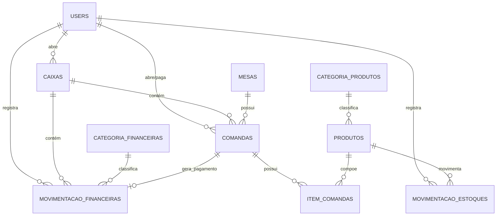

# Espetaria — Mapa Visual do Sistema

> Documento paralelo ao `README.md`, focado em **verificação visual e funcional**.
> Use este roteiro para navegar pelo sistema e conferir que cada fase funciona.
> Renderize os diagramas no GitHub (Mermaid) ou em qualquer preview Markdown.

**Como verificar em 10 minutos** (com o servidor em `http://127.0.0.1:3000`):

1. `/entrar` → Dashboard com 6 cards reais
2. `/caixa` → abrir caixa → `/mesas` → abrir comanda na Mesa 1
3. Na comanda → adicionar 2 pedidos → alterar quantidade → **PAGAR** via Pix
4. `/movimentacoes` → entrada única da venda → `/caixa` → fechar com conferência
5. `/produtos` → ver preços → `/estoque` → entrada manual → saldo muda
6. `/relatorios` → pílulas de período → gráficos → baixar 1 CSV

---

## 1. Jornada do usuário

```mermaid
flowchart TD
    A[/entrar/] --> B[/dashboard/]
    B --> C[/caixa/ abrir caixa]
    C --> D[/mesas/ abrir comanda]
    D --> E[/comandas/:id/ adicionar itens]
    E --> F[/comandas/:id/pagar/ Pix]
    F --> G[/movimentacoes/ entrada Venda única]
    G --> H[/caixa/:id/fechar/ conferência]
    B --> I[/produtos/ preços]
    I --> J[/estoque/ entrada manual]
    B --> K[/relatorios/ gráfico + CSV]
```

## 2. Mapa de módulos

| Módulo | Rota principal | Fase | Estado |
|---|---|---|---|
| Acesso (Devise, só login) | `/entrar`, `/sair` | 1 | ✅ |
| Dashboard real + filtro global | `/dashboard` | 6 | ✅ |
| Caixa (abre/fecha, conferência) | `/caixa` | 2 | ✅ |
| Financeiro (entradas/saídas) | `/movimentacoes` | 3 | ✅ |
| Produtos e categorias | `/produtos` | 4 | ✅ |
| Mesas e comandas | `/mesas`, `/comandas` | 4 | ✅ |
| Estoque manual | `/estoque` | 5 | ✅ |
| Relatórios, gráficos e CSV | `/relatorios` | 7 | ✅ |
| Interface mobile/desktop | todas | 8 | ✅ |
| Revisão (constraints, auditoria) | — | 9 | ✅ |
| Produção (Render + Neon) | — | 10 | ⏳ lado de fora |

## 3. Modelo de dados



**Regras de ouro** (verifique clicando):

| # | Regra | Onde verificar |
|---|---|---|
| 1 | Só 1 caixa aberto (validação + índice único) | Tentar abrir 2º em `/caixa/new` |
| 2 | Caixa fechado não muda | Editar via console é bloqueado; sem botões de edição |
| 3 | Fechar caixa com comanda aberta é bloqueado e lista as mesas | `/caixa/:id/fechar` com comanda aberta |
| 4 | Pagamento cria **1 única** entrada Venda vinculada | Pagar 2× (ou duplo clique) → mensagem de já registrado |
| 5 | Comanda zerada não paga | Comanda sem itens → alerta ao pagar |
| 6 | Preço do item é snapshot; backend ignora preço do browser | Mudar preço do produto → pedido antigo mantém valor |
| 7 | Preço mudou entre seleção e envio → pede confirmação | Integração cobre; fluxo manual: alterar preço em outra aba |
| 8 | Pedidos **não** baixam estoque | Adicionar item → saldo em `/estoque` intacto |
| 9 | Estoque nunca negativo (app + constraint) | Saída maior que saldo → erro, saldo intacto |
| 10 | Responsável sempre da sessão | Nenhum form tem campo de usuário |
| 11 | Sem edição/exclusão de lançamentos | Rotas só têm `index/new/create/show` |
| 12 | CSV neutraliza fórmulas (`'=1+1`) | Descrição `=1+1` → export com apóstrofo |

## 4. Filtro global de período (Dashboard + Relatórios)

```mermaid
flowchart LR
    subgraph Pílulas
    H[Hoje] --> S[Semana seg-dom] --> M[Mês] --> T[Trimestre] --> SE[Semestre] --> A[Ano] --> P[Personalizado]
    end
    P --> N[← Anterior | Próximo →]
    N --> D[Datas em America/Fortaleza]
    D --> Z[Totais, gráfico e lista mudam juntos]
```

- Inválido (ex.: `de > ate`) → volta para **Hoje** com aviso.
- Gráfico: dia (Hoje/Semana/Mês) · mês (Trimestre/Semestre/Ano) · personalizado ≤31d dia, ≤366d mês, acima ano. Vazios aparecem zerados.

## 5. Checklist de verificação por tela

| Tela | Verificar |
|---|---|
| Dashboard | 6 cards com valores; pílulas trocam totais; Anterior/Próximo; sem "Aguardando" |
| Caixa | Abrir com `100,00`; resumo; fechar com contado e diferença; histórico |
| Movimentações | Filtros tipo/categoria/pagamento; totais do filtro; detalhe |
| Produtos | Preço e badge À venda/Só estoque/Inativo; inativar em vez de excluir |
| Mesas | Livre/Ocupada; abrir comanda pede confirmação; histórico da mesa |
| Comanda | Adicionar com preço autopreenchido; qtd fracionada `1,5`; pagar com confirmação; após paga, itens congelados |
| Estoque | Badges Sem estoque/baixo/Normal; motivos filtrados por tipo; negativo bloqueado |
| Relatórios | 2 gráficos (canvas); média diária; pagamento; categorias; 4 CSVs com `;` e BOM |

## 6. Qualidade (último estado verificado)

| Verificação | Resultado |
|---|---|
| `rails test` | 160 runs, 845 assertions, 0 falhas |
| `rails test:system` (Edge headless) | 15 runs, 261 assertions, 0 falhas |
| `rubocop` | 93 arquivos, sem ofensas |
| `brakeman` | 0 warnings |
| `bundler-audit` + `importmap audit` | limpos |
| `zeitwerk:check` | OK |
| Varredura 390/768/1440 (`responsivo_test.rb`) | 27 páginas sem rolagem horizontal |

## 7. Pendências conhecidas (não são bugs)

- Status `cancelada` existe no modelo para o futuro; nenhum fluxo o cria (quando existir, tratar rótulos em 5 telas + CSV).
- Histórico do caixa soma por caixa (rápido e indexado); uma agregação única serviria se o volume crescer.
- Sem paginação nas listagens (suficiente para a escala; fora do escopo).
- Sem teto de valor nos forms (o `decimal(10,2/3)` limita; erro 500 do Postgres em absurdos — fora do uso real).
- Auditoria de segurança dedicada concluída em `docs/auditoria-seguranca.md`
  (13 achados, correções aplicadas e revalidadas; ver riscos residuais lá).
